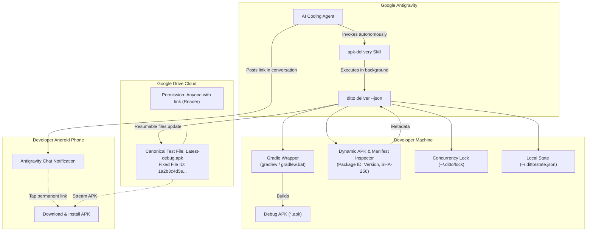

# Ditto 📲⚡

[](https://opensource.org/licenses/MIT)
[](https://nodejs.org/)
[](CONTRIBUTING.md)
[](CHANGELOG.md)

> **Zero-clutter Android debug APK delivery automation for Google Antigravity & mobile developers.**  
> One user. One permanent Google Drive testing link. Unlimited cross-project overwrites.

---

## 🎯 The Problem

AI coding assistants like **Google Antigravity** empower developers to build and modify Android apps autonomously—even from a mobile phone via remote control. However, when the agent completes a feature or bugfix, testing the actual Android build on physical hardware introduces manual friction:

- Building APKs manually or digging through `build/outputs/apk/debug/`.
- Uploading multiple APKs to cloud storage, causing storage sprawl and confusing filename suffixes (`app-debug-1.apk`, `app-debug-2.apk`).
- Constantly changing download links requiring the user to copy new URLs for every iteration.

## ✨ The Solution: Ditto

**Ditto** gives **Google Antigravity** the autonomous capability to build, inspect, and deliver fresh Android debug APKs straight to your physical device.

You don't need Android Studio open, you don't need emulators, and you never have to type build commands into a terminal. You simply chat with Antigravity as you normally do, and the built-in skill handles the compilation, packaging, and in-place cloud replacement silently in the background.

### Key Principles

1. **One Permanent Test Link:** Ditto creates and updates a single canonical file in your Google Drive (`Latest-debug.apk`). The Google Drive `fileId` and public download URL remain identical forever.
2. **Cross-Project In-Place Overwrites:** Working on *Project Alpha* in the morning and *Project Beta* in the afternoon? Ditto updates the same canonical file using Google Drive's `files.update` API without generating duplicate files.
3. **Self-Healing Recovery:** If your local machine configuration is ever deleted, Ditto uses custom Google Drive `appProperties` to locate your existing canonical file rather than creating an orphan duplicate.
4. **Agent-Centric Stream Separation:** When run with `--json`, `stdout` outputs strictly machine-readable JSON for Antigravity, while progress and Gradle logs stream to `stderr`.
5. **Least-Privilege Security:** Ditto requests only `https://www.googleapis.com/auth/drive.file`. It can **only** touch files it created and has zero access to your personal Drive documents, photos, or data.
6. **Zero-Database Simplicity:** No SQLite, Prisma, or background daemon. Configuration and state live in a single atomic JSON file (`~/.ditto/state.json`) protected by file locks.

---

## 🏗️ Architecture



---

## 🚀 Installation & Quick Start

### Option A: Zero-Install Instant Setup (Recommended)

Run the interactive setup wizard directly without installing anything beforehand:

```bash
npx github:oviii-001/Ditto setup
```

### Option B: Install Globally via npm

Install Ditto as a global system command on your machine:

```bash
# Direct GitHub installation:
npm install -g github:oviii-001/Ditto

# (Windows users): If your npm environment defaults to NTFS junctions, add --install-links:
npm install -g --install-links github:oviii-001/Ditto

# Or install from npm registry:
npm install -g ditto-apk

# Once installed, run setup:
ditto setup
```

### Option C: From Source (Developers & Contributors)

```bash
git clone https://github.com/oviii-001/Ditto.git
cd Ditto
npm install
npm link
ditto setup
```

---

### What Does `ditto setup` Do Automatically?

When you run `ditto setup`, it:
1. **Auto-installs the Antigravity Skill:** Detects your local Antigravity installation (`~/.gemini/config/skills/apk-delivery/` or `%USERPROFILE%\.gemini\...`) and copies the agent skill so your AI pair programmer knows how to deliver APKs right away.
2. **Connects Google Drive:** Guides you through signing in with your Google account via browser and configures least-privilege `drive.file` access.
3. **Creates the Canonical Drive File:** Sets up your permanent `Latest-debug.apk` file on Drive with public reader access and outputs your permanent download link.

---

## 🔑 Google Cloud Console Setup (One-Time & 100% Free)

Ditto connects to your Google Drive using Google's standard OAuth 2.0 Desktop App protocol.

> [!NOTE]
> **Zero Cost ($0.00 / Free Forever):**  
> Google Drive API provides **1,000,000,000 free requests per day**. Google does **not** charge for personal desktop OAuth authentication, and **no credit card or paid billing account is required**.

### Step 1: Create a Google Cloud Project
1. Open [Google Cloud Console](https://console.cloud.google.com/).
2. Click the project dropdown at the top-left and select **New Project**.
3. Name it **Ditto APK Delivery** (or any name you prefer) and click **Create**.

### Step 2: Enable the Google Drive API
1. In your project, go to **APIs & Services > Library** (or search for `Google Drive API`).
2. Select **Google Drive API** and click **Enable**.

### Step 3: Configure the OAuth Consent Screen
1. Go to **APIs & Services > OAuth consent screen**.
2. Select **External** user type and click **Create**.
3. Fill in the basic app details:
   - **App name:** `Ditto`
   - **User support email:** Select your Gmail address.
   - **Developer contact information:** Enter your email address.
   - Click **Save and Continue**.
4. **Scopes:** Click **Add or Remove Scopes**, find and select:
   - `https://www.googleapis.com/auth/drive.file` *(View and manage Google Drive files that you have opened or created with this app)*.
   - Click **Update** and then **Save and Continue**.
5. **Test users:** Under "Test users", click **Add Users** and enter your personal Google email address (the one you will sign in with).
6. Click **Save and Continue**.

> [!IMPORTANT]
> **Don't Skip "Test Users":**  
> While your Google Cloud project is in "Testing" mode (the default), Google will **block** any Google account that is not explicitly added under **Test users**. Be sure to add your Gmail address here!

### Step 4: Create Desktop OAuth Client Credentials
1. Go to **APIs & Services > Credentials**.
2. Click **+ Create Credentials** at the top and select **OAuth client ID**.
3. In the **Application type** dropdown, select **Desktop app**. *(Do NOT select "Web application")*.
4. Name it **Ditto Desktop** and click **Create**.
5. A modal will pop up displaying your **Client ID** and **Client Secret**. Copy both values.

> [!WARNING]
> **Must Be "Desktop app":**  
> Choosing *Web application* requires pre-registering exact redirect URLs and will cause a `redirect_uri_mismatch` error. Selecting **Desktop app** allows Google to automatically redirect to local loopback ports (`http://127.0.0.1:*`).

### Step 5: Connect Ditto
Run the setup wizard in your terminal:
```bash
ditto setup
```
When prompted:
1. Ditto asks if you want to open Google Cloud Console (press Enter or `n` if already open).
2. Paste your **Client ID**.
3. Paste your **Client Secret**.
4. Ditto prints the authorization link and automatically launches your browser.
5. Click **Allow** on the consent screen.

Your tokens are saved securely to `~/.ditto/state.json`. You never have to configure this again!

> [!TIP]
> **Troubleshooting OAuth Timeout:**
> If you encounter `OAuth authentication timed out after 120 seconds`:
> 1. Check that your Gmail address was added under **OAuth consent screen > Test users**.
> 2. Check that your credential type is **Desktop app** (not Web application).
> 3. If your browser didn't open automatically, copy the URL printed in the terminal into your browser.

> [!TIP]
> **Environment Variables Alternative:**  
> You can also bypass the interactive prompts by setting environment variables in your terminal profile (`.bashrc`, `.zshrc`, or PowerShell `$PROFILE`):
> ```bash
> export DITTO_CLIENT_ID="your-client-id.apps.googleusercontent.com"
> export DITTO_CLIENT_SECRET="your-client-secret"
> ```

---

## 🤖 How to Use in Google Antigravity (Zero IDE & Zero CLI)

The core principle of Ditto is that **you never need an IDE (like Android Studio) or a command line terminal**. Once setup is done, your entire workflow happens through natural conversation inside **Google Antigravity**.

### 1. Hands-Free Automatic Delivery (Default)

Whenever you ask Antigravity to build, edit, fix, or refactor anything in an Android project, the built-in `apk-delivery` skill automatically activates as soon as the code changes are complete.

**Conversational examples you say to Antigravity:**
> *"Add biometric authentication to the login screen."*  
> *"Fix the crash when opening the profile picture gallery."*  
> *"Refactor the network layer to use Ktor and make sure it builds."*

**What Antigravity does autonomously:**
1. Antigravity writes the Kotlin / Compose code and runs project checks.
2. The `apk-delivery` skill triggers behind the scenes.
3. Antigravity compiles `gradlew assembleDebug` in the background, extracts APK metadata (package name, version, SHA-256), and in-place updates your permanent `Latest-debug.apk` file on Google Drive.
4. Antigravity posts an interactive completion card directly into the chat with your permanent download link.

---

### 2. On-Demand Chat Prompts

You can also prompt Antigravity at any moment to deliver the latest build without making code changes:

- 💬 *"Deliver the APK to my phone"*
- 💬 *"Build the debug APK and send it to my Google Drive link"*
- 💬 *"Ship this build so I can test it on my physical device"*
- 💬 *"Give me the latest APK download link"*

Antigravity executes the delivery pipeline in the background and returns your download card immediately.

---

### 3. The "Bookmark Once, Test Forever" Mobile Workflow

Because Ditto continuously updates the exact same file on Google Drive across all your projects:

1. **Bookmark the link on your phone:** Open your permanent download link in your phone's browser (e.g., Chrome) once, and tap **"Add to Home screen"** or save it to bookmarks.
2. **Develop from anywhere:** Code with Antigravity from your laptop, desktop, or even remotely from your mobile device.
3. **Instant Installation:** Whenever Antigravity finishes a task or you ask for a build, simply open that same home screen icon on your phone to download and install the freshest build. No digging through chat history, no multiple links, and zero storage clutter.

---

### 📱 What You See in Antigravity Chat

When a delivery succeeds, Antigravity renders a structured notification card directly in your conversation:

> ### 📱 Android Build Ready for Testing!
> - **Project:** DIU Campus Schedule (`com.diu.schedule`)
> - **Version:** 1.0.4 (Build 42)
> - **Size:** 18.4 MB
> - **Build Time:** 22.4s | **Upload:** 6.8s
> - **Permanent Download Link:** [Download Latest-debug.apk](https://drive.google.com/file/d/1a2b3c4d5e.../view?usp=sharing)
> 
> *(This replaces the previous test build on your phone's permanent testing link).*

---

### 📦 Antigravity Skill Installation Details

When you run `ditto setup` (or `npx github:oviii-001/Ditto setup`), the skill is automatically placed in your Antigravity skills directory:
- **Windows:** `%USERPROFILE%\.gemini\config\skills\apk-delivery\SKILL.md`
- **macOS / Linux:** `~/.gemini/config/skills/apk-delivery/SKILL.md`

Antigravity discovers new skills dynamically without requiring an application restart.

---

## 💻 Manual Terminal / CLI Reference (Optional)

If you are writing custom CI/CD automation scripts or prefer triggering builds manually from a command prompt:

| Command | Description |
|---|---|
| `ditto deliver` | Compile debug APK, inspect metadata, upload to Drive in-place, and return URL |
| `ditto deliver --json` | Agent mode (outputs pure JSON to `stdout`, logs to `stderr`) |
| `ditto setup` | Run interactive wizard to install Antigravity skill & connect Google Drive |
| `ditto auth` | Re-authenticate Google Cloud OAuth credentials via browser |
| `ditto status` | Display current canonical Drive file ID, permanent URLs, and last delivery details |
| `ditto doctor` | Diagnose environment (Java, Gradle wrapper, OAuth validity, Drive connection) |
| `ditto --version` | Display the installed Ditto version |

---

## 🗑️ Uninstalling Ditto

To completely remove Ditto, its local configuration, and the Antigravity agent skill from your system:

### 1. Remove the Global CLI
```bash
npm uninstall -g ditto-apk
```

### 2. Remove Local Configuration & Cached Tokens
Ditto stores your configuration and tokens in `~/.ditto/`:

```powershell
# Windows (PowerShell):
Remove-Item -Recurse -Force "$HOME\.ditto"
```

```bash
# macOS / Linux:
rm -rf ~/.ditto
```

### 3. Remove the Antigravity Agent Skill (Optional)
If you installed the agent skill for Google Antigravity:

```powershell
# Windows (PowerShell):
Remove-Item -Recurse -Force "$HOME\.gemini\config\skills\apk-delivery"
```

```bash
# macOS / Linux:
rm -rf ~/.gemini/config/skills/apk-delivery
```

---

## 🤝 Contributing

Contributions are welcome! Please see [CONTRIBUTING.md](CONTRIBUTING.md) for instructions on setting up your local environment, running tests, and following our commit conventions.

## 📄 License

Ditto is licensed under the [MIT License](LICENSE).
