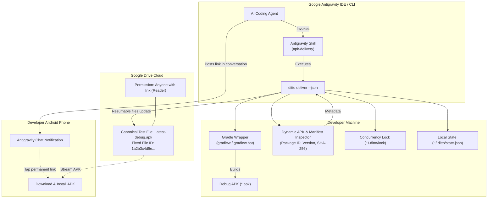

# Ditto 📲⚡

[](https://opensource.org/licenses/MIT)
[](https://nodejs.org/)
[](CONTRIBUTING.md)
[](#project-status)

> **Zero-clutter Android debug APK delivery automation for Google Antigravity & mobile developers.**  
> One user. One permanent Google Drive testing link. Unlimited cross-project overwrites.

---

## 🎯 The Problem

AI coding assistants like **Google Antigravity** empower developers to build and modify Android apps autonomously—even from a mobile phone via remote control. However, when the agent completes a feature or bugfix, testing the actual Android build on physical hardware introduces manual friction:

- Building APKs manually or digging through `build/outputs/apk/debug/`.
- Uploading multiple APKs to cloud storage, causing storage sprawl and confusing filename suffixes (`app-debug-1.apk`, `app-debug-2.apk`).
- Constantly changing download links requiring the user to copy new URLs for every iteration.

## ✨ The Solution: Ditto

**Ditto** gives your AI agent (or CI/terminal workflow) a single, reliable command:
```bash
ditto deliver
```

### Key Principles

1. **One Permanent Test Link:** Ditto creates and updates a single canonical file in your Google Drive (`Latest-debug.apk`). The Google Drive `fileId` and public download URL remain identical forever.
2. **Cross-Project In-Place Overwrites:** Working on *Project Alpha* in the morning and *Project Beta* in the afternoon? Ditto updates the same canonical file using Google Drive's `files.update` API without generating duplicate files.
3. **Self-Healing Recovery:** If your local machine configuration is ever deleted, Ditto uses custom Google Drive `appProperties` to locate your existing canonical file rather than creating an orphan duplicate.
4. **Agent-Centric Stream Separation:** When run with `--json`, `stdout` outputs strictly machine-readable JSON for Antigravity, while progress and Gradle logs stream to `stderr`.
5. **Least-Privilege Security:** Ditto requests only `https://www.googleapis.com/auth/drive.file`. It can **only** touch files it created and has zero access to your personal Drive documents, photos, or data.
6. **Zero-Database Simplicity:** No SQLite, Prisma, or background daemon. Configuration and state live in a single atomic JSON file (`~/.ditto/state.json`) protected by file locks.

---

## 🏗️ Architecture



---

## 🚀 Quick Start

### 1. Installation

Install globally via npm or run directly via `npx`:

```bash
# Global installation (reusable anywhere)
npm install -g ditto-apk

# Or test directly with npx without installing
npx ditto-apk --help
```

### 2. Fast Setup (`ditto auth`)

Run the setup wizard:

```bash
ditto auth
```

1. **Automated Helper:** Ditto offers to open the Google Cloud Console credentials page directly in your browser.
2. Select **"Desktop app"** and paste your Client ID & Secret.
   *(You can also set `DITTO_CLIENT_ID` and `DITTO_CLIENT_SECRET` in your shell environment to bypass prompts entirely).*
3. The browser opens to sign in with Google.
4. **Done!** Ditto creates your permanent `Latest-debug.apk` file on Google Drive and outputs your permanent testing link.

### 3. Delivering an APK

From any Android project directory:

```bash
ditto deliver
```

Ditto will:
1. Locate the Gradle wrapper (`gradlew` or `gradlew.bat`).
2. Run `assembleDebug`.
3. Locate the freshly generated `.apk` and parse its package ID and version.
4. Overwrite your canonical Google Drive APK in place.
5. Print the permanent download link and summary.

---

## 🤖 Antigravity AI Agent Integration

Ditto includes a global Antigravity Skill that enables your AI pair programmer to automatically deliver APKs after finishing tasks.

### Install the Skill in Antigravity

Copy `skills/apk-delivery` to your Antigravity skills directory:

- **Windows:** `%USERPROFILE%\.gemini\antigravity\skills\apk-delivery\`
- **macOS / Linux:** `~/.gemini/antigravity/skills/apk-delivery/`

Once installed, your agent automatically invokes `ditto deliver --json` when completing Android tasks and posts an interactive summary card in the chat:

> ### 📱 Android Build Ready for Testing!
> - **Project:** DIU Campus Schedule (`com.diu.schedule`)
> - **Version:** 1.0.4 (Build 42)
> - **Size:** 18.4 MB
> - **SHA-256:** `3a4b...b210`
> - **Download Link:** [Download Latest-debug.apk](https://drive.google.com/file/d/1a2b3c4d5e.../view?usp=sharing)
>
> *(This replaces the previous test build on your phone's permanent testing link).*

---

## 💻 CLI Command Reference

| Command | Description |
|---|---|
| `ditto auth` | Configure Google Cloud OAuth credentials and authenticate via browser |
| `ditto deliver` | Compile debug APK, inspect metadata, upload to Drive, and return download URL |
| `ditto deliver --json` | Machine-readable mode (outputs pure JSON to `stdout` for agents) |
| `ditto status` | Display current canonical Drive file ID, permanent URLs, and last delivery details |
| `ditto doctor` | Diagnose environment (Java, Gradle wrapper, OAuth validity, Drive connection) |

---

## 📋 Project Status

| Phase | Milestone | Status |
|---|---|---|
| **Phase 1** | Project Scaffolding & Atomic State Engine | 🟢 Completed |
| **Phase 2** | Android Build Engine & Dynamic APK Inspector | 🟢 Completed |
| **Phase 3** | Google Drive Overwrite Engine (`files.update`) | 🟢 Completed |
| **Phase 4** | CLI Router, Antigravity Skill, and E2E Tests | 🟢 Completed |

See [tasks/plan.md](tasks/plan.md) and [tasks/todo.md](tasks/todo.md) for detailed task breakdowns and progress.

---

## 🤝 Contributing

Contributions are welcome! Please see [CONTRIBUTING.md](CONTRIBUTING.md) for instructions on setting up your local environment, running tests, and following our commit conventions.

## 📄 License

Ditto is licensed under the [MIT License](LICENSE).
