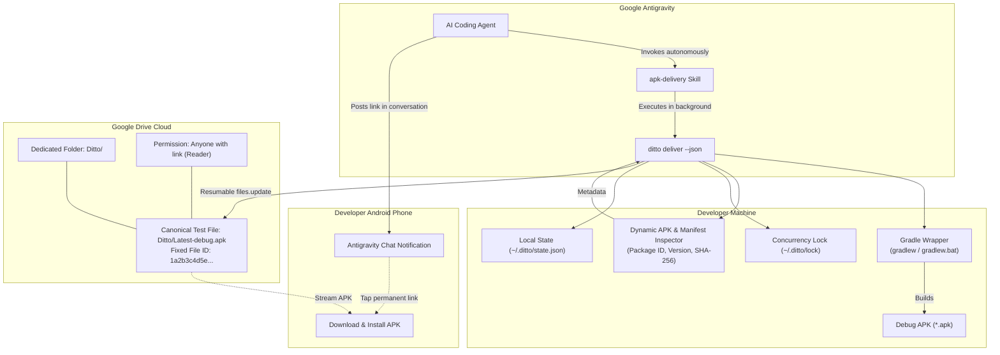
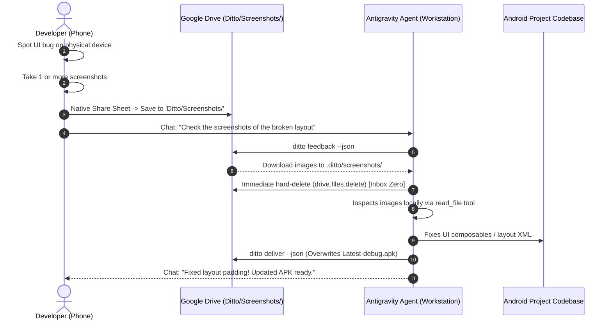

<div align="center">
  
  <h1>Ditto 📲⚡</h1>
  <p>
    <a href="https://opensource.org/licenses/MIT"></a>
    <a href="https://nodejs.org/"></a>
    <a href="CONTRIBUTING.md"></a>
    <a href="CHANGELOG.md"></a>
  </p>
  <p>
    <strong>Automated APK delivery & visual feedback skills for <a href="https://antigravity.google.com">Google Antigravity</a>.</strong><br />
    Deliver debug APKs to phone on a permanent link → test remotely → share bug screenshots to Drive → Antigravity pulls, purges remote (Inbox Zero), and fixes code.<br />
    <em>Built for Android developers pair-programming via Antigravity's remote control from their phone.</em>
  </p>
</div>

---

## 🎯 The Problem

**Google Antigravity** has a built-in remote control system. Android developers can monitor and guide the AI agent directly from their phone—watching it write code, run checks, and build the project in real time.

But there's a gap: **once the agent finishes the task and builds the debug APK, there's no way for the developer to test it on their phone**. The compiled APK sits on the host machine. Getting it onto a physical device requires:

- Manually locating the build output buried in `build/outputs/apk/debug/`.
- Uploading to a cloud storage service—which creates a new file and a new link every single time (`app-debug-1.apk`, `app-debug-2.apk`, ...).
- Copying and sharing the new URL back into the conversation, breaking the "develop from phone" flow entirely.

This turns what should be a seamless remote development loop into a multi-step manual process each time the agent completes a build.

## ✨ The Solution: Ditto

**Ditto** is an automation skill for **Google Antigravity** that closes the gap between finishing an Android task and testing it on your phone.

The moment Antigravity completes a task, the `apk-delivery` skill kicks in automatically:

1. Compiles the debug APK using the project's Gradle wrapper.
2. Uploads it to your Google Drive—**overwriting the same single file every time**, regardless of which project it came from.
3. Posts the permanent download link directly **in the same Antigravity chat conversation** you're already watching on your phone.

You tap the link, download the APK, install it, and test. No switching apps, no copying URLs, no Drive clutter.

### Key Principles

1. **One Permanent Test Link:** Ditto creates and updates a single canonical file inside a dedicated `Ditto/` folder in your Google Drive (`Ditto/Latest-debug.apk`). The Google Drive `fileId` and public download URL remain identical forever.
2. **Cross-Project In-Place Overwrites:** Working on *Project Alpha* in the morning and *Project Beta* in the afternoon? Ditto updates the same canonical file using Google Drive's `files.update` API without generating duplicate files.
3. **Self-Healing Recovery:** If your local machine configuration is ever deleted, Ditto uses custom Google Drive `appProperties` to locate your existing canonical file rather than creating an orphan duplicate.
4. **Agent-Centric Stream Separation:** When run with `--json`, `stdout` outputs strictly machine-readable JSON for Antigravity, while progress and Gradle logs stream to `stderr`.
5. **Least-Privilege Security:** Ditto requests only `https://www.googleapis.com/auth/drive.file`. It can **only** touch files it created and has zero access to your personal Drive documents, photos, or data.
6. **Zero-Database Simplicity:** No SQLite, Prisma, or background daemon. Configuration and state live in a single atomic JSON file (`~/.ditto/state.json`) protected by file locks.

---

## 🏗️ Architecture



---

## 🚀 Installation & Quick Start

### Option A: Zero-Install Instant Setup (Recommended)

Run the interactive setup wizard directly without installing anything beforehand:

```bash
npx github:oviii-001/Ditto setup
```

### Option B: Install Globally via npm

Install Ditto as a global system command on your machine:

```bash
# Direct GitHub installation:
npm install -g github:oviii-001/Ditto

# (Windows users): If your npm environment defaults to NTFS junctions, add --install-links:
npm install -g --install-links github:oviii-001/Ditto

# Or install from npm registry:
npm install -g ditto-apk

# Once installed, run setup:
ditto setup
```

### Option C: From Source (Developers & Contributors)

```bash
git clone https://github.com/oviii-001/Ditto.git
cd Ditto
npm install
npm link
ditto setup
```

---

### What Does `ditto setup` Do Automatically?

When you run `ditto setup`, it:
1. **Auto-installs the Antigravity Skill:** Detects your local Antigravity installation (`~/.gemini/config/skills/apk-delivery/` or `%USERPROFILE%\.gemini\...`) and copies the agent skill so your AI pair programmer knows how to deliver APKs right away.
2. **Connects Google Drive:** Guides you through signing in with your Google account via browser and configures least-privilege `drive.file` access.
3. **Creates the Dedicated Drive Folder & File:** Sets up a dedicated `Ditto/` folder and your permanent `Ditto/Latest-debug.apk` file on Drive with public reader access ready for automated delivery.

---

## 🔑 Google Cloud Console Setup (One-Time & 100% Free)

Ditto connects to your Google Drive using Google's standard OAuth 2.0 Desktop App protocol.

> [!NOTE]
> **Zero Cost ($0.00 / Free Forever):**  
> Google Drive API provides **1,000,000,000 free requests per day**. Google does **not** charge for personal desktop OAuth authentication, and **no credit card or paid billing account is required**.

### Step 1: Create a Google Cloud Project
1. Open [Google Cloud Console](https://console.cloud.google.com/).
2. Click the project dropdown at the top-left and select **New Project**.
3. Name it **Ditto APK Delivery** (or any name you prefer) and click **Create**.

### Step 2: Enable the Google Drive API
1. In your project, go to **APIs & Services > Library** (or search for `Google Drive API`).
2. Select **Google Drive API** and click **Enable**.

### Step 3: Configure the OAuth Consent Screen
1. Go to **APIs & Services > OAuth consent screen**.
2. Select **External** user type and click **Create**.
3. Fill in the basic app details:
   - **App name:** `Ditto`
   - **User support email:** Select your Gmail address.
   - **Developer contact information:** Enter your email address.
   - Click **Save and Continue**.
4. **Scopes:** Click **Add or Remove Scopes**, find and select:
   - `https://www.googleapis.com/auth/drive.file` *(View and manage Google Drive files that you have opened or created with this app)*.
   - Click **Update** and then **Save and Continue**.
5. **Test users:** Under "Test users", click **Add Users** and enter your personal Google email address (the one you will sign in with).
6. Click **Save and Continue**.

> [!IMPORTANT]
> **Don't Skip "Test Users":**  
> While your Google Cloud project is in "Testing" mode (the default), Google will **block** any Google account that is not explicitly added under **Test users**. Be sure to add your Gmail address here!

### Step 4: Create Desktop OAuth Client Credentials
1. Go to **APIs & Services > Credentials**.
2. Click **+ Create Credentials** at the top and select **OAuth client ID**.
3. In the **Application type** dropdown, select **Desktop app**. *(Do NOT select "Web application")*.
4. Name it **Ditto Desktop** and click **Create**.
5. A modal will pop up displaying your **Client ID** and **Client Secret**. Copy both values.

> [!WARNING]
> **Must Be "Desktop app":**  
> Choosing *Web application* requires pre-registering exact redirect URLs and will cause a `redirect_uri_mismatch` error. Selecting **Desktop app** allows Google to automatically redirect to local loopback ports (`http://127.0.0.1:*`).

### Step 5: Connect Ditto
Run the setup wizard in your terminal:
```bash
ditto setup
```
When prompted:
1. Ditto asks if you want to open Google Cloud Console (press Enter or `n` if already open).
2. Paste your **Client ID**.
3. Paste your **Client Secret**.
4. Ditto prints the authorization link and automatically launches your browser.
5. Click **Allow** on the consent screen.

Your tokens are saved securely to `~/.ditto/state.json`. You never have to configure this again!

> [!TIP]
> **Troubleshooting OAuth Timeout:**
> If you encounter `OAuth authentication timed out after 120 seconds`:
> 1. Check that your Gmail address was added under **OAuth consent screen > Test users**.
> 2. Check that your credential type is **Desktop app** (not Web application).
> 3. If your browser didn't open automatically, copy the URL printed in the terminal into your browser.

> [!TIP]
> **Environment Variables Alternative:**  
> You can also bypass the interactive prompts by setting environment variables in your terminal profile (`.bashrc`, `.zshrc`, or PowerShell `$PROFILE`):
> ```bash
> export DITTO_CLIENT_ID="your-client-id.apps.googleusercontent.com"
> export DITTO_CLIENT_SECRET="your-client-secret"
> ```

---

## 🤖 Using the Ditto Skills in Antigravity

> [!IMPORTANT]
> Ditto is designed exclusively for **Google Antigravity** (the conversational AI agent with remote control). It does **not** target Antigravity IDE or the `agy` CLI—those products do not have the remote control system that creates the delivery problem Ditto solves.

### How It Works: The Complete Two-Way Testing Loop

Running `ditto setup` registers two complementary, symbiotic skills into your Antigravity environment to form a closed-loop mobile testing pipeline:

<table>
  <thead>
    <tr>
      <th align="left" nowrap>Skill</th>
      <th align="left" nowrap>Direction &amp; Purpose</th>
      <th align="left" nowrap>When It Triggers</th>
      <th align="left">What Ditto Does</th>
    </tr>
  </thead>
  <tbody>
    <tr>
      <td nowrap><b><code>apk-delivery</code></b></td>
      <td nowrap>📤 <b>Outbound</b> (Workstation → Phone)</td>
      <td nowrap>Task completion or <code>/apk-delivery</code></td>
      <td>Compiles debug APK with Gradle, overwrites canonical <code>Latest-debug.apk</code> on Drive, and posts your permanent test link in chat.</td>
    </tr>
    <tr>
      <td nowrap><b><code>apk-feedback</code></b></td>
      <td nowrap>📥 <b>Inbound</b> (Phone → Workstation)</td>
      <td nowrap>Phone screenshots or <code>/apk-feedback</code></td>
      <td>Streams screenshots from Drive into <code>.ditto/screenshots/</code>, <b>hard-deletes remote files immediately (Inbox Zero)</b>, and inspects UI defects.</td>
    </tr>
  </tbody>
</table>

> [!TIP]
> **The Autonomous Mobile Loop:** Build an APK $\to$ test on physical phone $\to$ share bug screenshot(s) to Drive $\to$ Antigravity diagnoses the defect, writes the fix, and automatically re-delivers the updated APK to the same permanent link.

---

### Invoking the Skills

You can trigger both skills in Antigravity either via explicit slash commands or natural language:

#### 1. Outbound: `apk-delivery`

- **Slash Command:**
  ```
  /apk-delivery
  ```
- **Natural Language:**
  ```
  deliver the apk to my phone
  ```
  ```
  build and send the apk to my drive
  ```
  ```
  give me the apk download link
  ```
- **Automatic Execution:** The skill also activates **automatically** at the end of any Android coding task—no prompt needed.

#### 2. Inbound: `apk-feedback`

- **Slash Command:**
  ```
  /apk-feedback
  ```
- **Natural Language:**
  ```
  check my screenshots
  ```
  ```
  look at the UI bug I found on my phone
  ```
  ```
  I uploaded 2 screenshots of the checkout screen, please fix the layout
  ```
  ```
  pull screenshots from my drive
  ```

---

### 1. Automatic Delivery After a Task

Just ask Antigravity to work on your Android project as you normally would:

> *"Add biometric authentication to the login screen."*  
> *"Fix the crash when opening the gallery."*  
> *"Refactor the data layer and make sure it compiles."*

**What Antigravity does after completing the code changes:**
1. Detects the task involves an Android project with a Gradle wrapper.
2. Invokes the `apk-delivery` skill in the background.
3. Runs `gradlew assembleDebug`, inspects the APK (package name, version, SHA-256), and uploads it to your Google Drive—overwriting the existing file in-place.
4. Posts a notification card directly in the chat with your permanent download link.

You see the card on your phone, tap the link, and install the build.

---

### 2. On-Demand Delivery

You can also trigger delivery at any time without asking for code changes:

- 💬 `/apk-delivery`
- 💬 *"Build the APK and send it to my Drive"*
- 💬 *"Deliver the latest build to my phone"*
- 💬 *"Give me the download link for the current build"*

---

### 3. Notification Card in Chat

When delivery succeeds, Antigravity posts this directly in your conversation:

> ### 📱 Android Build Ready for Testing!
> - **Project:** DIU Campus Schedule (`com.diu.schedule`)
> - **Version:** 1.0.4 (Build 42)
> - **Size:** 18.4 MB
> - **Build Time:** 22.4s | **Upload:** 6.8s
> - **Permanent Download Link:** [Download Latest-debug.apk](https://drive.google.com/file/d/1a2b3c4d5e.../view?usp=sharing)
>
> *(This replaces the previous test build on your phone's permanent testing link).*

---

### 4. The "Bookmark Once, Test Forever" Workflow

Because the Drive link never changes:

1. Bookmark the permanent download link in your phone's browser (or add it to your home screen).
2. Every time Antigravity delivers a new build—from any project—open that same bookmark to instantly download and install the latest APK.

No digging through chat history. No multiple links. One bookmark, works forever.

---

## 📸 Inbound Visual Feedback: The `apk-feedback` Skill

When pair-programming with Antigravity through remote control on your phone, **you cannot attach images directly into the chat**. If you spot a visual defect, misaligned padding, or truncated text while testing the APK on your phone, how do you show Antigravity the bug?

Ditto solves this with the **"Ephemeral Buffer / Inbox Zero"** pattern:



### Why This Architecture is Senior-Grade:

1. **Multi-Screenshot Native Batching**:
   Android's system Share Sheet lets you select multiple images in Google Photos / Gallery simultaneously $\to$ Share $\to$ Drive $\to$ `Ditto/Screenshots` $\to$ Save.
2. **Immediate Remote Purge (Inbox Zero)**:
   Once Ditto streams the images into `.ditto/screenshots/`, it immediately deletes them from Google Drive.
   - Zero Drive storage wasted.
   - The remote folder is drained back to 0 files, so the agent is **never confused by stale screenshots** from yesterday.
3. **Pre-Build Auto-Sweep**:
   When `ditto deliver` runs to deploy an updated APK, it automatically sweeps and purges any abandoned screenshots, guaranteeing a fresh start for every test cycle.

### Invoking `apk-feedback`

Just say in chat:
- 💬 *"Check my screenshots"*
- 💬 *"Look at the UI bug I found on my phone"*
- 💬 `/apk-feedback`
- 💬 *"I uploaded 2 screenshots of the checkout screen, please fix the layout"*

---

### 📦 Installed Skills

Ditto installs two complementary skills to Antigravity:
- **`apk-delivery`**: Outbound delivery (Workstation $\to$ Google Drive $\to$ Phone).
- **`apk-feedback`**: Inbound visual feedback (Phone screenshots $\to$ Google Drive $\to$ Workstation).

**Locations:**
- **Windows:** `%USERPROFILE%\.gemini\config\skills\apk-delivery\` & `...\apk-feedback\`
- **macOS / Linux:** `~/.gemini/config/skills/apk-delivery/` & `.../apk-feedback/`

Antigravity discovers skills dynamically—no restart required after installation.

---

## 🗑️ Uninstalling Ditto

### 1. Remove the Antigravity Skills

```powershell
# Windows (PowerShell):
Remove-Item -Recurse -Force "$HOME\.gemini\config\skills\apk-delivery"
Remove-Item -Recurse -Force "$HOME\.gemini\config\skills\apk-feedback"
```

```bash
# macOS / Linux:
rm -rf ~/.gemini/config/skills/apk-delivery ~/.gemini/config/skills/apk-feedback
```

### 2. Remove Local Configuration & Cached Tokens

```powershell
# Windows (PowerShell):
Remove-Item -Recurse -Force "$HOME\.ditto"
```

```bash
# macOS / Linux:
rm -rf ~/.ditto
```

### 3. Remove the Ditto Package

```bash
npm uninstall -g ditto-apk
```

---

## 🤝 Contributing

Contributions are welcome! Please see [CONTRIBUTING.md](CONTRIBUTING.md) for instructions on setting up your local environment, running tests, and following our commit conventions.

## 📄 License

Ditto is licensed under the [MIT License](LICENSE).
