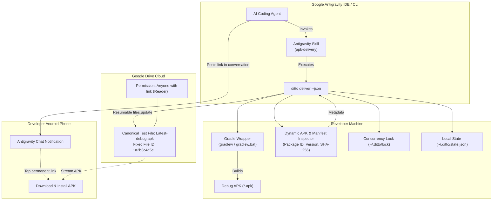

# Ditto 📲⚡

[](https://opensource.org/licenses/MIT)
[](https://nodejs.org/)
[](CONTRIBUTING.md)
[](#project-status)

> **Zero-clutter Android debug APK delivery automation for Google Antigravity & mobile developers.**  
> One user. One permanent Google Drive testing link. Unlimited cross-project overwrites.

---

## 🎯 The Problem

AI coding assistants like **Google Antigravity** empower developers to build and modify Android apps autonomously—even from a mobile phone via remote control. However, when the agent completes a feature or bugfix, testing the actual Android build on physical hardware introduces manual friction:

- Building APKs manually or digging through `build/outputs/apk/debug/`.
- Uploading multiple APKs to cloud storage, causing storage sprawl and confusing filename suffixes (`app-debug-1.apk`, `app-debug-2.apk`).
- Constantly changing download links requiring the user to copy new URLs for every iteration.

## ✨ The Solution: Ditto

**Ditto** gives your AI agent (or CI/terminal workflow) a single, reliable command:
```bash
ditto deliver
```

### Key Principles

1. **One Permanent Test Link:** Ditto creates and updates a single canonical file in your Google Drive (`Latest-debug.apk`). The Google Drive `fileId` and public download URL remain identical forever.
2. **Cross-Project In-Place Overwrites:** Working on *Project Alpha* in the morning and *Project Beta* in the afternoon? Ditto updates the same canonical file using Google Drive's `files.update` API without generating duplicate files.
3. **Self-Healing Recovery:** If your local machine configuration is ever deleted, Ditto uses custom Google Drive `appProperties` to locate your existing canonical file rather than creating an orphan duplicate.
4. **Agent-Centric Stream Separation:** When run with `--json`, `stdout` outputs strictly machine-readable JSON for Antigravity, while progress and Gradle logs stream to `stderr`.
5. **Least-Privilege Security:** Ditto requests only `https://www.googleapis.com/auth/drive.file`. It can **only** touch files it created and has zero access to your personal Drive documents, photos, or data.
6. **Zero-Database Simplicity:** No SQLite, Prisma, or background daemon. Configuration and state live in a single atomic JSON file (`~/.ditto/state.json`) protected by file locks.

---

## 🏗️ Architecture



---

## 🚀 Installation & Quick Start

### Option A: One-Liner (No installation required)

Run the interactive setup wizard directly from GitHub without installing anything beforehand:

```bash
npx github:oviii-001/Ditto setup
```

### Option B: Install Globally via npm

Install Ditto as a global system command on your machine:

```bash
# Install directly from GitHub:
npm install -g github:oviii-001/Ditto

# Or install from npm registry (once published):
npm install -g ditto-apk

# Run the 1-minute setup wizard:
ditto setup
```

### Option C: From Source (Developers & Contributors)

```bash
git clone https://github.com/oviii-001/Ditto.git
cd Ditto
npm install
npm link
ditto setup
```

---

### What Does `ditto setup` Do Automatically?

When you run `ditto setup`, it:
1. **Auto-installs the Antigravity Skill:** Detects your local Antigravity installation (`~/.gemini/config/skills/apk-delivery/` or `%USERPROFILE%\.gemini\...`) and copies the agent skill so your AI pair programmer knows how to deliver APKs right away.
2. **Connects Google Drive:** Guides you through signing in with your Google account via browser and configures least-privilege `drive.file` access.
3. **Creates the Canonical Drive File:** Sets up your permanent `Latest-debug.apk` file on Drive with public reader access and outputs your permanent download link.

---

## 📲 Everyday Usage

Once setup is complete, you never need to run setup again!

### 1. Fully Autonomous (with Antigravity AI Agent)

Just talk to Antigravity as usual when developing your Android app:
> *"Finish implementing the new user profile screen and build the APK for testing."*

Antigravity writes the code, compiles the build, runs `ditto deliver --json` in the background, and returns your permanent testing link directly in chat.

### 2. Manual CLI (from any terminal)

Inside any Android project directory on your machine:

```bash
ditto deliver
```

Ditto compiles `assembleDebug`, detects the generated APK, updates your permanent Google Drive file in place, and prints the download link.

---

## 🤖 Antigravity AI Agent Integration

Ditto includes a global Antigravity Skill that enables your AI pair programmer to automatically deliver APKs after finishing tasks.

### Install the Skill in Antigravity

Copy `skills/apk-delivery` to your Antigravity skills directory:

- **Windows:** `%USERPROFILE%\.gemini\antigravity\skills\apk-delivery\`
- **macOS / Linux:** `~/.gemini/antigravity/skills/apk-delivery/`

Once installed, your agent automatically invokes `ditto deliver --json` when completing Android tasks and posts an interactive summary card in the chat:

> ### 📱 Android Build Ready for Testing!
> - **Project:** DIU Campus Schedule (`com.diu.schedule`)
> - **Version:** 1.0.4 (Build 42)
> - **Size:** 18.4 MB
> - **SHA-256:** `3a4b...b210`
> - **Download Link:** [Download Latest-debug.apk](https://drive.google.com/file/d/1a2b3c4d5e.../view?usp=sharing)
>
> *(This replaces the previous test build on your phone's permanent testing link).*

---

## 💻 CLI Command Reference

| Command | Description |
|---|---|
| `ditto auth` | Configure Google Cloud OAuth credentials and authenticate via browser |
| `ditto deliver` | Compile debug APK, inspect metadata, upload to Drive, and return download URL |
| `ditto deliver --json` | Machine-readable mode (outputs pure JSON to `stdout` for agents) |
| `ditto status` | Display current canonical Drive file ID, permanent URLs, and last delivery details |
| `ditto doctor` | Diagnose environment (Java, Gradle wrapper, OAuth validity, Drive connection) |

---

## 📋 Project Status

| Phase | Milestone | Status |
|---|---|---|
| **Phase 1** | Project Scaffolding & Atomic State Engine | 🟢 Completed |
| **Phase 2** | Android Build Engine & Dynamic APK Inspector | 🟢 Completed |
| **Phase 3** | Google Drive Overwrite Engine (`files.update`) | 🟢 Completed |
| **Phase 4** | CLI Router, Antigravity Skill, and E2E Tests | 🟢 Completed |

See [tasks/plan.md](tasks/plan.md) and [tasks/todo.md](tasks/todo.md) for detailed task breakdowns and progress.

---

## 🤝 Contributing

Contributions are welcome! Please see [CONTRIBUTING.md](CONTRIBUTING.md) for instructions on setting up your local environment, running tests, and following our commit conventions.

## 📄 License

Ditto is licensed under the [MIT License](LICENSE).
